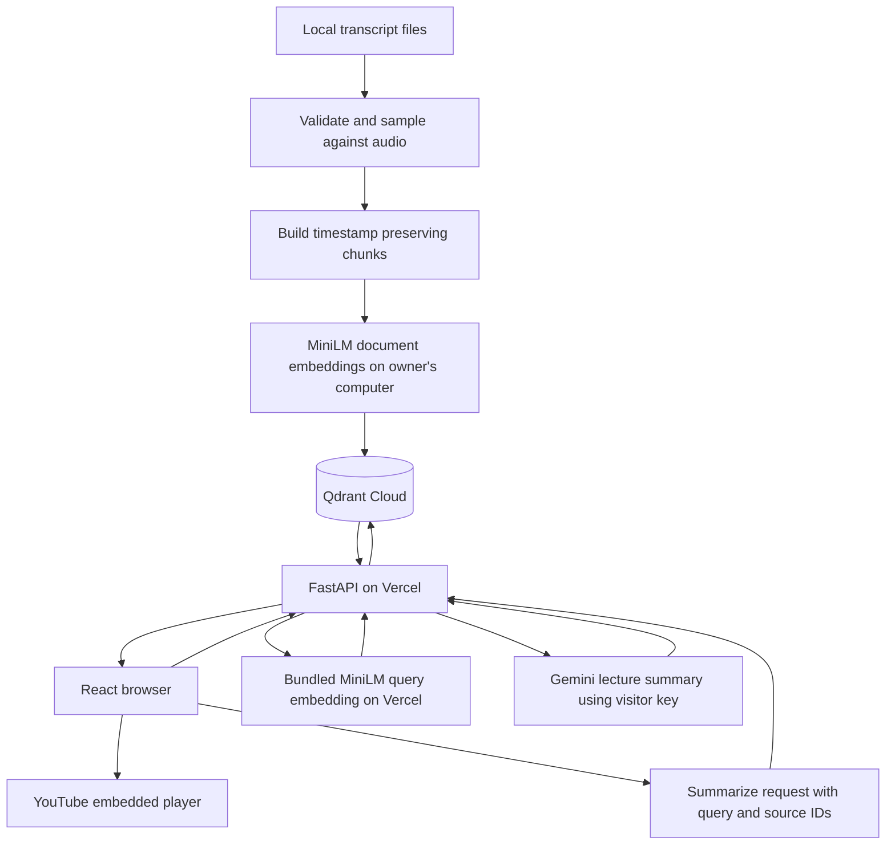

# RecallQ Project Context

Planning baseline: November 13, 2026. Product name: RecallQ, pronounced Recall Q. Suggested tagline: Find where you learned it.

This is the implementation brief for a new application. Requirements below come from the project discussion. Proposed engineering defaults are labeled. Nothing in this file establishes that the application, deployment, transcript accuracy, or performance has already been verified.

Read this file and `DESIGN.md` before implementation. Keep both updated when decisions change. The user will create and clone the GitHub repository, copy these files to its root, and open that folder in Codex. Application coding begins when the user instructs Codex to start.


## Implementation status

The implementation is available at https://recallq-app.vercel.app. The GitHub repository is public. React, FastAPI, personal-key handling, Qdrant search, optional Gemini summaries and source navigation are implemented. The current preparation step imports 121 matching tutorial transcripts from a playlist with 125 unique IDs. The active indexed count is recorded in data/manifest.json, not inferred from the file count. Audio accuracy is not certified.

November 14 update: the user selected local MiniLM embeddings after Gemini ingestion hit its free quota. Both indexing and deployed query encoding now use the pinned sentence-transformers/all-MiniLM-L6-v2 ONNX model, mean pooling, and normalized 384-dimensional vectors. Runtime is ONNX Runtime plus tokenizers and NumPy, with no PyTorch. Assets are downloaded and checksum-verified at build time, then bundled into the Vercel Python function. Queries execute on Vercel, independently of the owner's laptop. Search requires no Gemini key; summaries still require the visitor's key.

Qdrant's existing collection is 768-dimensional and its credentials are collection-scoped. MiniLM's 384 normalized coordinates are extended with 384 zeroes for storage and query. This preserves cosine similarity exactly. Payloads retain model, revision, native dimension, and corpus revision; filtering isolates the new corpus from old Gemini points. Never mix vectors from different encoders in one search. A dedicated 384-dimensional collection can replace this compatibility step if collection-management access is added later.

MiniLM passages use a 220-token text budget and at most 32 title tokens, within the model's 256-token limit including special tokens. Split long ASR segments at word boundaries, retain original coarse timestamps, and overlap up to 40 tokens using complete pieces. Raw transcript files stay unchanged. scripts/index_minilm.py caches local vectors, checkpoints completed videos, and verifies the remote passage count before promotion. The older Gemini ingestion script and failed MLX experiments are historical tools, not the active workflow.

Serving credentials are read-only and scoped to the RecallQ collection; local ingestion has a separate scoped write key. The existing Qdrant free cluster was reactivated without altering its existing credentials. The new Gemini RecallQ project remains on the free tier; no billing was enabled. Runtime generation uses gemini-3.5-flash-lite after checking actual project access. The custom Camera Plain font was not supplied. The user subsequently requested typography improvements; the app now self-hosts DM Sans under its original SIL Open Font License. Dark warm-charcoal mode is the default, with a persistent cream light mode and native animated transitions that respect reduced motion. Vercel CLI deployment works, but automatic GitHub integration remains unconnected. See README.md for commands and verification details.

## 1 Product requirements

### Problem and purpose

Students remember a concept or problem from a long YouTube course but cannot find the video and moment where it was explained. Titles do not expose every subtopic. RecallQ searches the spoken content and returns useful places to resume watching.

The main product is lecture navigation. A short, source-based summary supports it. This is also a personal tool the owner intends to use while learning DSA, and a portfolio project for full-stack and AI engineering roles alongside Orbit.

Build an original implementation. The tutorial is a reference and a possible transcript source, not code to copy wholesale. Interview value should come from a working product, measured retrieval, understandable decisions, and clearly stated limitations.

### Agreed MVP

| Priority | Feature | Expected behavior |
| --- | --- | --- |
| P0 | One curated DSA corpus | Search the selected playlist lessons that have usable transcripts. Show indexed coverage. |
| P0 | Personal Gemini key | Require a visitor-supplied key for summaries only. Search uses the bundled MiniLM model. No owner-funded summary key. |
| P0 | Key storage choice | Default to page memory. An unchecked Remember on this device checkbox opts into local storage. Include Forget key. |
| P0 | Independent searches | Accept a topic or question in English or romanized Hinglish. No conversational history. |
| P0 | Ranked video moments | Show strongest relevant matches first, with video title, timestamp or range, and transcript excerpt. |
| P0 | Video navigation | Selecting a result loads or seeks the embedded YouTube player. Include Open on YouTube. |
| P0 | Lecture summary on request | Generate only after Summarize is clicked. Use retrieved lecture text and clickable citations. Follow the query language. |
| P0 | Clear failure states | Handle invalid keys, provider limits, unsupported requests, weak retrieval, missing data, and playback failures. |
| P0 | Lovable design | Follow the user-supplied guide in DESIGN.md. Provide desktop and mobile layouts. |
| P1 | Retrieval verification | Check real revision questions against manually identified video passages. Report measured results. |
| P1 | Deployed application | Deploy React and FastAPI on Vercel, with Qdrant Cloud external to Vercel. |

Current result presentation: return and display at most five strongest matches. There is no Show more or pagination. Summaries use these visible matches. Remove redundant overlapping passages while preserving distinct useful moments from the same video.

Pure Hindi script is optional and must be tested before advertising support. English and romanized Hinglish are the required query languages.

### Outside this MVP

Accounts, authentication, bookmarks, personal notes, saved search history, private content, public playlist submission, multiple providers, multi-turn chat, quizzes, generated study plans, and general explanations outside the lectures are deferred. Do not add demo quotas or an owner-funded summary allowance. Provider-enforced limits remain real and must be explained when encountered.

### Main user journey

1. Open RecallQ and see the playlist context and example searches.
2. Search immediately without an API key. Connect a Gemini key only if a summary is requested, choosing whether to remember it.
3. Search a topic such as sliding window, or a question such as memoization aur tabulation ka difference kahan bataya hai.
4. Read ranked excerpts. Select a timestamp to watch the relevant moment.
5. Click Summarize if an explanation is wanted. Follow its citations back to the source moments.
6. Change or forget the key through a small settings control.

## 2 Stack and system architecture

### Settled stack

| Layer | Choice | Role |
| --- | --- | --- |
| UI | React and TypeScript | Search, result selection, player control, summary and key state |
| Styling | Tailwind CSS | Implement the Lovable guide with consistent tokens |
| Frontend tooling | Vite | Development server and production assets |
| Backend | Python and FastAPI | Validate requests, call Gemini, search Qdrant, build citations |
| Vector storage | Qdrant Cloud | Shared public lecture index and associated text metadata |
| Embeddings | MiniLM ONNX | Same pinned local encoder for offline documents and deployed queries |
| Answer generation | Gemini | Requested summaries using the visitor's own key |
| Deployment | Vercel | Serve the React build and Python API |
| Offline processing | Local Python scripts | Transcript checks, optional transcription, chunking, indexing |

A relational/document database is unnecessary for the agreed scope. Raw transcripts and manifests are files. Qdrant stores vectors and the text needed to answer. Browser storage holds only the visitor's chosen local preferences and optionally their Gemini key. Do not introduce extra hosted services without a concrete need.

### Two separate processing paths



The owner indexes the corpus once using local CPU inference and the scoped Qdrant write key. Visitors do not re-embed the playlist. Search calls no embedding API. Summarize consumes the visitor's Gemini generation quota. Hosting and Qdrant free-plan resource limits still apply.

Candidate ranking combines the MiniLM cosine score with a small keyword-overlap boost capped at 0.08. A measured near-tie had a heap analogy above the actual remove-duplicates lesson; keyword overlap improved that ordering without re-embedding. This is a lightweight reranking step, not a separate sparse-vector database. Weak-match status uses the original semantic score.

### Current model configuration

Use the pinned MiniLM model in backend/embedding-model.json for both documents and questions. The previous gemini-embedding-001 attempt stopped on provider quota and is no longer the active encoder. No full-corpus transcription is requested.

Select a currently available generation model with suitable free API access during the preflight. Put its identifier in configuration rather than scattering it through the code. Do not assume the owner's Google AI Pro subscription increases backend API quotas, or that every visitor has identical access.

Document and query vectors must use the same embedding model, dimensions, and normalization policy. Re-embed the corpus when changing to an incompatible model. Do not load the tutorial's prebuilt vectors into a Gemini-based collection.

### Deployment shape

Prefer a single Vercel project: static frontend assets plus `/api/*` FastAPI routes. Verify this with a minimal deployment early. Keep Qdrant external and keep all ingestion outside request handlers and deployment startup. Vercel function memory, execution duration, package size, and free-plan usage limits apply.

Use same-origin API requests in production. Restrict development CORS to the actual frontend origin if separate local servers require it. Do not add Next.js merely for hosting. Deployment address availability for recallq has not been confirmed; a longer slug is acceptable without changing the product name.

## 3 Key handling and application boundaries

Proposed simple implementation: the browser sends the visitor key over HTTPS in `X-Gemini-API-Key` to FastAPI for that request. FastAPI forwards it to the configured Gemini API. It is not stored in a database, transcript, Qdrant payload, server file, shared client configuration, or application cache.

The UI must say that the key is forwarded through the backend to Google and whether it is remembered in this browser. Do not claim the server never sees it. Never place keys in URLs, application source, public Vite variables, error responses, analytics, or request logs. Redact validation errors so they do not echo secrets. Keep per-request credentials isolated; never mutate a shared client's key across users.

Use an in-memory variable or state for the default. Refreshing or closing the page removes that temporary value. If Remember on this device is checked, save the key in local storage and restore it on later visits. Forget key clears both locations. If the user turns remembering off, remove any previously saved key. Disabling browser storage must leave temporary mode usable.

Local storage is readable by scripts running on our origin. An unrelated website normally cannot read it, but compromised same-origin scripts or privileged extensions can. Render model and transcript text safely; do not inject untrusted HTML. Keep the choice explicit and avoid claims of complete protection.

The Qdrant credential belongs only on the server. Use a collection-scoped read credential for serving where supported; local ingestion uses a separate write credential. Anonymous visitors search one public corpus. There is no tenant isolation claim and no account boundary in this MVP.

## 4 Transcript preparation and retrieval

### Approved local pipeline update, November 14, 2026

Keep one fixed DSA playlist. Public playlist imports, browser transcription, accounts and multi-playlist UI are outside this implementation. The owner approved an independently written local pipeline using the tutorial as a reference, not copying its code.

Use full FP16 Whisper large-v3 through MLX on Apple silicon. The existing reference uses faster-whisper large-v3 with an English language hint; its files are mostly English-rendered speech rather than faithful Roman Hinglish. The new pipeline uses transcription, not translation, with a Hindi hint for this Hinglish course. English-only and automatic-language settings are available for local use. Preserve raw ASR and derive a Roman-letter view with local rule-based uroman transliteration; do not use an LLM to rewrite speech. Roman spellings and ASR words can still be wrong.

The retrieval baseline is now 75 seconds with approximately 15 seconds of segment-aligned overlap. It is separate from audio decode windows. A Hindi sample exhausted MLX's default 224 output-token budget at about 14 seconds. Raising it and shortening windows restored that sample, but a real Lecture 4 audit later exposed repeated hallucinations. An experimental 12-second decoder with word alignment, deterministic decoding and a vocabulary hint still failed on one section after a six-second retry. The quality guard stopped the job and retained rejected evidence. Do not claim this MLX configuration is production-ready. The same full large-v3 model is being checked through whisper.cpp as an alternative native engine; do not silently reduce model size or precision.

Latest user scope: test **only Lecture 4, PvyEr3CeKzE**, approximately 30 minutes. The full-playlist worker is stopped. Measure whole-Mac memory, app-family footprints and swap, run a real restart/offline-continuation test, and inspect actual audio samples before recommending a full run. No indexing or live-corpus promotion is authorized by this demo request. The restart/offline test successfully reused the first two saved MLX windows and decoded a further window with outbound networking denied, before the later ASR quality failure. The user reported the Mac usable with noticeable lag. A concurrent React build succeeded in about 2.3 seconds with approximately 284 MiB peak RSS; this is not a guarantee for arbitrary development workloads.

The runner uses one video at a time, a process lock, disk checks (20 GiB to start, 8 GiB reserve while processing), pause/resume controls, network retries and a macOS memory-pressure guard. The speech model is released while waiting on memory pressure. Downloads and cloud indexing need internet; cached audio transcription does not. No billing or paid transcription service is introduced.

Generated audio, raw results, status, and checkpoints live in ignored data/local-transcription. The existing live corpus stays available while new content is prepared. Optional indexing uses an inactive Qdrant corpus revision and a separate manifest; promotion to the live app is a later validation step. Previous local transcript copies are backed up before replacement. Never modify or delete the separate course reference repository.

Actual full-model runtime must be measured. Earlier 48–72-hour discussion was an unmeasured planning allowance, not a verified forecast. A first 50-second sample took about 126 seconds and later samples vary substantially. Do not claim a finished corpus, complete word accuracy, comfortable multitasking, or a fixed completion time based on those samples.

### Existing reference and findings

Local reference repository, for inspection only:

`/Users/theajay/Documents/Programming/Personal/padho-with-pratyush-ai-engineer`

Relevant locations are `notes/15c-converting-60-hour-dsa-playlist-to-rag.md` and `week-3/ytscraper`. Read that repository's instructions before working inside it. Do not alter it to build RecallQ.

Playlist: https://www.youtube.com/playlist?list=PLbJhGqY-mq47k_WLUtzVjmarUm1EuXPj2

Audit snapshot from November 13, 2026:

- 126 local transcript JSON files, containing 9,844 segments and about 68.7 hours of video-duration metadata.
- All files record model large-v3 and language en. The inspected implementation uses yt-dlp audio downloads and faster-whisper. Metadata is consistent with that process but does not independently prove every file's provenance.
- Basic checks found no empty transcripts, invalid or unordered segment timestamps, or identical segment strings repeated at least five times within a video. These checks do not establish speech accuracy or rule out every hallucination.
- Text inspection found likely technical-term errors, including lead code for LeetCode and Cadence Algorithm in Kadane lecture transcripts. Audio comparison is still required.
- The current playlist listing returned 126 entries and 125 unique video IDs. Local transcripts matched 121 of those unique IDs. Five local transcripts were absent from the current listing; they are older prefix-sum lessons and must not be silently treated as current playlist members.

Missing transcript IDs in that snapshot:

| Video ID | Listed title or status |
| --- | --- |
| pNd8NnYoQVM | Prefix Sum Easy Hai Yaar; appears twice in the playlist |
| mFVj745MLmU | How Does A Senior Engineer Solve Leetcode? |
| Z9CI_OVhXNs | I converted my 60 Hour DSA Playlist to a RAG! |
| 83iS3DZPn9g | No title was returned; availability unverified |

Recheck the playlist before ingestion. Curate the teaching corpus; the RAG demo video can be excluded deliberately. Coverage in the UI must come from the actual manifest and successful index, not the historical file count. Deleted, unavailable, excluded, pending, and indexed are different statuses.

### Quality gate and ingestion

November 14 decision: reuse the tutorial corpus. A fresh playlist listing again returned 126 entries and 125 unique IDs. Copy only the 121 matching transcript files, unchanged; keep five older prefix-sum lessons outside the current playlist out of the index. See data/transcript-audit.json for the dated audit and missing links. Keep the one completed local Lecture 4 transcript as a separate comparison, not an additional video. No further ASR is authorized in this step. Index available material in a staged revision, verify counts and retrieval, then publish it for the user's manual check. Missing videos remain pending.

Six sampled comparisons from Lecture 4 showed broadly similar concepts and errors in both versions. Tutorial English text was easier to read; local Romanized Hinglish did not establish an overall accuracy improvement. The successful CPU baseline measured 83m13s for 30m10s of audio, approximately 4 GiB worker footprint, and memory-pressure warnings. At that speed the selected 67.53-hour playlist would take about 186 hours, excluding downloads and indexing. This cost is not justified by the observed quality difference.

Sample original audio from several videos, including technical names and later passages. Check meaning, technical terminology, and timing. The decision to reuse all existing transcripts is conditional on this sampling. Re-transcribe poor or missing lessons selectively. Re-running the same model and settings is not evidence of improvement.

Preserve raw transcripts. Store verified corrections separately with provenance. Do not globally replace ambiguous words without checking context. Do not ask an LLM to invent missing teaching content. If full preparation takes too long, ship a clearly labeled subset of validated lessons and process the remainder later.

Proposed chunking baseline: 60 to 90 second, segment-aligned windows with modest overlap. Preserve constituent segment boundaries and prefix embedding input with the video title. Store clean transcript text separately from that prefix. Retain raw start/end seconds; do not derive timestamps from generated prose.

Indexing must be resumable and idempotent. Checkpoint per video, cache reusable embeddings with model/version metadata, and replace stale video chunks when re-chunking. Transcription and embedding calls must never rerun on server startup. Avoid committing downloaded audio, credentials, caches, or generated vectors unnecessarily.

### Search and summaries

Search Qdrant for a bounded candidate set, rank by relevance, and remove near-duplicate overlapping windows. Use the title and transcript as evidence. Add lexical reranking or verified technical-term aliases only when labeled queries show a benefit. A similarity score is not a probability of correctness; tune weak-match behavior on this corpus.

Select a segment-level playback anchor when supported by the retrieved passage. Otherwise show an honest passage time range. A chunk timestamp is not proof of the exact second a concept begins. A small rewind can improve context, but keep playback time separate from the source start time.

Selecting a result uses the YouTube IFrame API to load a new video or seek within the current video. Respect user gestures and browser playback restrictions. If embedding or autoplay fails, retain the source and offer Open on YouTube at the same time.

Summarize only the selected retrieved evidence for the current query, in English or Hinglish as appropriate. Use short answers with valid source IDs. Resolve citation URLs and timestamps on the server from indexed data. If evidence is insufficient, say it was not found in the indexed material, rather than claiming the full course never teaches it.

Valid citation IDs do not prove that every sentence is supported. Check factual support in evaluation. Treat transcript instructions as source content, not instructions for the application. Show search results even when summarization fails, and never generate a summary automatically after a search.

## 5 Data design

Use JSON files for raw transcripts and a corpus manifest. The manifest records the selected playlist, curation decisions, per-video status, transcript source/hash, and indexing configuration. It contains no API keys. Qdrant points hold one vector plus the payload needed for search and citations.

Proposed point identity: deterministic UUID derived from corpus ID, video ID, transcript revision, chunking version, and segment range. A new revision must replace or exclude old points so retries cannot create visible duplicates.

| Payload field | Purpose |
| --- | --- |
| corpus_id | Select the fixed DSA corpus |
| video_id and video_title | Identify and label the source |
| source_id | Stable point UUID used by API citations |
| start_sec and end_sec | Original passage interval |
| segments | Constituent start/end/text records for anchoring |
| text | Transcript passage presented as evidence |
| transcript_hash and transcript_source | Trace the passage to its input |
| chunk_version | Identify the chunking policy |
| embedding_model and embedding_dimension | Prevent incompatible search configuration |

Record a collection or corpus revision for API responses. Do not label model-generated summaries as original transcript excerpts. Build watch URLs from stored video IDs and validated numeric times.

## 6 Proposed API contract

All routes use `/api`. JSON field names use snake_case consistently. These contracts are a starting design; update this file and frontend types together if implementation changes them. Public keys below are placeholders only.

| Method and route | Purpose | Visitor key |
| --- | --- | --- |
| GET /api/health | Lightweight process health; no model call | Not required |
| GET /api/corpus | Playlist identity, corpus revision, actual indexed coverage | Not required |
| POST /api/search | Embed query and return ranked source passages | Required |
| POST /api/summarize | Load source IDs and generate supported summary | Required |

Use `X-Gemini-API-Key` for keyed requests. No login token is required. A format check alone does not validate a key; the first real provider operation determines access. Avoid an extra paid validation call on every visit.

### Search

Request:

```json
{"query":"sliding window kab use karna hai","limit":5}
```

Current bounds: trimmed query from 1 to 1,000 characters, default and maximum response count of five. Older requests with a limit up to 20 are accepted but clamped to five for compatibility. Reject blank input before model calls. Cancel or ignore stale browser results when a newer search starts.

Response shape:

```json
{
  "query": "sliding window kab use karna hai",
  "corpus_revision": "revision-id",
  "match_state": "matches",
  "results": [
    {
      "source_id": "point-uuid",
      "video_id": "youtube-video-id",
      "video_title": "Lecture title",
      "start_sec": 340.0,
      "end_sec": 410.0,
      "playback_sec": 335.0,
      "excerpt": "Original transcript passage",
      "watch_url": "https://www.youtube.com/watch?v=youtube-video-id&t=335s"
    }
  ]
}
```

The values above illustrate structure and are not measured lecture facts. `match_state` is matches, weak, or none; it is advisory and must be calibrated. If numeric similarity is returned for debugging, do not display it as a confidence percentage.

### Summarize

Request:

```json
{
  "query": "sliding window kab use karna hai",
  "corpus_revision": "revision-id",
  "source_ids": ["point-uuid"]
}
```

Allow at most six unique source IDs and a bounded context size. Load their original text from the configured Qdrant corpus; do not trust client-supplied transcript text or URLs. Reject unknown IDs or an obsolete revision clearly. This endpoint does not need to re-embed the query.

Response:

```json
{
  "status": "answered",
  "summary": "Short lecture-based explanation with [1].",
  "citations": [
    {
      "number": 1,
      "source_id": "point-uuid",
      "video_id": "youtube-video-id",
      "video_title": "Lecture title",
      "playback_sec": 335.0,
      "watch_url": "https://www.youtube.com/watch?v=youtube-video-id&t=335s"
    }
  ]
}
```

Use `status: insufficient_evidence` with an explanatory message and empty citations when needed. Require valid citations for a successful lecture-based answer. Never invent replacement source metadata.

### Errors

Use a consistent safe envelope such as `{"error":{"code":"GEMINI_QUOTA_EXCEEDED","message":"Your Gemini quota is unavailable. Try again later."}}`.

Distinguish input validation, missing/invalid key, unavailable model or project access, upstream quota, missing sources, provider failure, and timeout. Typical statuses are 422, 401, 403, 404 or 409 for stale data, 429 for upstream quota, 503, and 504. Map real provider errors carefully; not every upstream 400 is invalid user input. Hide secrets and internal stack traces. Do not retry invalid keys or quota failures in an unbounded loop.

## 7 Interface design and implementation shape

`DESIGN.md` is the visual authority. The user chose the supplied Lovable guide, including Camera Plain Variable where legitimately available. Do not silently replace it with Inter, mix the Arc/Clay/OpenAI systems into it, or add unrelated marketing sections.

Keep a small header with RecallQ and key settings. Before search, show the actual playlist and useful examples. After search, make the evidence list and player easy to scan together. Display full or sensibly wrapped titles, readable excerpts, precise timestamp controls, a clear selected result, and the optional summary. On narrow screens stack the workspace without horizontal overflow.

Cover empty, searching, matches, weak/no matches, player unavailable, summarizing, summary ready, invalid key, quota exhausted, and service failure states. Keyboard users must be able to reach search, results, key settings, summary citations, and player controls. Keep focus visible and status changes understandable without relying on color.

Suggested small repository structure, to adapt as needed:

```text
PROJECT_CONTEXT.md
DESIGN.md
frontend/          React source and Vite configuration
backend/           FastAPI routes, schemas, retrieval, Gemini integration
scripts/           Local transcript checks, chunking, indexing and evaluation
data/              Manifest, verified corrections, evaluation labels
tests/             Meaningful backend and workflow checks
README.md
.env.example       Names and placeholders only
```

Prefer direct SDK calls and simple modules. Use normal TypeScript interfaces, inferred types, and straightforward React state. Keep Python readable with functions, small Pydantic request/response models, and explicit errors. Use async provider/database calls or avoid blocking the event loop. Avoid abstractions whose only purpose is adding technologies to the resume.

## 8 Build order and completion checks

1. Inspect the actual new repository and its instructions. Confirm the documented font asset and the available Gemini/Qdrant project access without printing secrets.
2. Build a small React/FastAPI deployment on Vercel and confirm `/api/health` and frontend routing. Retain the deployment configuration for the real app.
3. Validate and sample a few transcript files, record failures, and index a small verified subset. Check embedding compatibility before processing the full corpus.
4. Implement one complete keyed search through Gemini and Qdrant. Confirm returned times against source passages.
5. Build the Lovable interface, key controls, result navigation and YouTube playback around that real search.
6. Add explicit Summarize with source resolution and citations. Preserve search results through summary errors.
7. Check failure cases, retrieval labels, mobile/keyboard use, and concurrent requests. Deploy the complete supported subset and write setup instructions.
8. Expand the corpus and fix measured retrieval problems. Keep the UI honest about coverage.

Completion means a real visitor can enter their key, search actual indexed lessons, watch a returned moment, and request a supported summary. Hardcoded answers and mocked provider responses are useful during development but do not establish completion.

Create 15 to 20 manually checked queries spanning topics, English/Hinglish phrasing, difficult technical terms, and questions outside the indexed material. Record expected video IDs and approximate time intervals. Measure video hit rate separately from passage overlap within an explicit tolerance. Explain the tolerance and small sample size. Check summary support and weak-match behavior manually as well. Do not claim 100 percent grounding or exact timestamp accuracy from a similarity threshold.

Add meaningful checks for timestamp/link conversion, idempotent chunk replacement, source-ID validation, error redaction, incompatible embeddings, and isolation of simultaneous visitor keys. Exercise a full search-to-playback-to-summary flow. Test 5 to 10 concurrent users or equivalent requests as a target; do not claim capacity until measured under stated conditions.

Keep a short record of an actual failure, the change made, and its measured effect. No latency, accuracy, traffic, or resume metrics are established at planning time.

## 9 Collaboration and learning expectations

The owner knows React/JavaScript and basic Python, but is new to TypeScript and FastAPI. Codex will implement and review the application while the owner guides decisions and checks the output. Build the working application first. Save the detailed teaching and interview walkthrough for afterward, unless the owner asks earlier.

During implementation, give concise progress updates and explain material tradeoffs. Keep a short decision log in the repository rather than delivering long lessons after every edit. At the end, explain:

- The complete request journey from React to FastAPI, Gemini, Qdrant and back.
- TypeScript types, interfaces, nullable state, props, API response types, and the difference between compile-time types and runtime validation, using the actual code.
- Python dictionaries, type hints, imports, Pydantic models, route decorators, async/await, dependencies and error handling that were actually used.
- Comparisons with Express routes, JavaScript objects, Zod-style validation, middleware and familiar database concepts where accurate.
- Chunking, embeddings, ranking, timestamp limits, citations, failure handling, deployment, and why the chosen architecture fits this scope.
- Likely interview questions, supported by implementation details and measured results rather than memorized claims.

Keep communication simple, short and direct. Ask only for real blockers or unresolved product choices. The user creates the GitHub repository and provides the cloned workspace. Do not publish, create accounts or repositories, or change the agreed product scope merely because this brief mentions future steps.

## 10 Decisions to verify during implementation

The product name, Lovable design direction, TypeScript/FastAPI stack, Gemini-only access, personal-key flow, Qdrant Cloud and Vercel hosting are settled. The following details still need evidence or an implementation choice:

- Legitimate availability of Camera Plain Variable; the guide supplies fallback families but no font binary or font license.
- Final generation model, actual key/project access, embedding baseline quality, and calibrated weak-match behavior.
- Audio accuracy of existing transcripts, curation decisions, and final indexed coverage.
- Working deployment routing and available deployment slug. The product name is not a reserved URL.
- Actual timing quality, response latency, and concurrency results.

Do not fabricate results or silently treat these as completed checks.

## 11 Reference documentation

Consult current official documentation when implementing library or hosting details. These links support capabilities, not claims that RecallQ is already working.

- [FastAPI](https://fastapi.tiangolo.com/)
- [Gemini embeddings](https://ai.google.dev/gemini-api/docs/embeddings)
- [Gemini API keys](https://ai.google.dev/gemini-api/docs/api-key)
- [Gemini project rate limits](https://ai.google.dev/gemini-api/docs/rate-limits)
- [Qdrant points and payloads](https://qdrant.tech/documentation/concepts/points/)
- [FastAPI on Vercel](https://vercel.com/docs/frameworks/backend/fastapi)
- [Vercel Hobby plan](https://vercel.com/docs/plans/hobby)
- [YouTube IFrame Player API](https://developers.google.com/youtube/iframe_api_reference)
- [Lovable design reference supplied by the user](https://opendesignmd.com/designs/lovable-dev/)
- [OpenDesignMD license information](https://opendesignmd.com/licenses/)


### Skiper UI refinements

Search uses the free Skiper UI SmoothInput (skiper106), adapted to the existing field without its demo control panel. Attribution: https://skiper-ui.com/v1/skiper106. Framer Motion drives the spring caret. Native input editing and selection are retained; touch, IME composition, and reduced-motion preferences use a native caret.

Theme changes use a 450ms circular View Transition originating at the toggle. There is no GIF loading, masking, or decoding. Reduced motion and unsupported browsers switch immediately. This replaces the GIF variant following the user's decision to prioritize smoothness.

The Open Peeps crowd sits between the hero copy and search. It retains pause/resume, offscreen suspension, reduced-motion support, dense sprites, and feathered canvas edges. Illustrations: https://www.openpeeps.com/ (CC0). Crowd concept: https://skiper-ui.com/v1/skiper39.

The side flower/scroll illustration is removed. Results retain five accessible cards. Their hover expansion is a reading-focused adaptation of https://skiper-ui.com/v1/skiper53, with spring layout movement, a gentle surface/shadow response, and an explicit Read full passage button for touch and keyboard. Staggered entry and movement respect reduced motion. No Pro components are used.

“Keep learning at your own pace.” sits above the headline. The shared main container is capped at 1440px with responsive gutters; the query stays within 840px and reading prose within 70 characters. The footer follows the main container width, with playlist, source, and back-to-top links.

Responsive refinement: the key dialog portal uses explicit overlay/content layers (100/101), above the page and filtered canvas. Short laptop screens place hero copy and the larger crowd side by side above search; smaller screens stack them. The middle header tagline is removed. Crowd opacity is full with stronger monochrome contrast, and body/supporting text is larger. The dialog scrolls internally on small screens.

Latest refinement: show two matches initially and reveal the remaining relevant matches (up to five total) through Show more. New searches reset the expanded list; summaries use visible passages and are cleared when expanding the list. The bookshelf has an actual opening-video thumbnail and a full-row responsive layout. Crowd tones are softened from full black/white. Backend relevance filtering removes low-scoring candidates and requires query-term evidence for borderline semantic matches.
